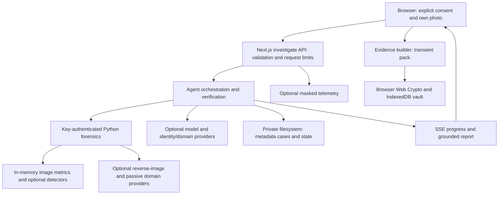

# HerGuard

HerGuard is a single-owner image and domain investigation workbench: a Next.js interface with a separate Python forensics service. It produces indicators and reviewable drafts, not proof of identity, authenticity, infringement or legal entitlement. Local processing is the default configuration; optional providers can still receive requests.



No candidate-image gallery, face search, social-media scraping or automatic takedown sending is implemented. Candidate provider images are not persisted or displayed. The vault supports explicitly supplied own images; downloaded evidence is the owner's responsibility.

## Windows setup

Use PowerShell in `C:\dev\herguard`, Node 22 and Python 3.11. If the virtual environment already exists, reuse it.

```powershell
npm ci
py -3.11 -m venv forensics/.venv
forensics/.venv/Scripts/python.exe -m pip install -r forensics/requirements.txt
# Required for the release gate, optional for base runtime:
forensics/.venv/Scripts/python.exe -m pip install -r forensics/requirements-pdq.txt
Copy-Item .env.example .env.local
Copy-Item forensics/.env.example forensics/.env
```

Edit both private environment files. Set the same strong FORENSICS_API_KEY in each. Clear placeholder optional keys; set real model credentials only if you want model calls. For base-only operation set DEEPFAKE_MODEL_ID empty in the Python environment; leave CLIP_ENABLED, DINOV2_ENABLED and GEND_ENABLED false. Never commit these files.

In separate terminals:

```powershell
powershell -File scripts/start-backend.ps1
npm run dev
```

Open http://localhost:3000 and inspect Settings/health. Python binds 127.0.0.1:8000. Missing tools must appear unavailable or degraded. Optional model setup is described in [forensics/README.md](forensics/README.md); review [licences](docs/LICENSES.md) first.

## Feature status

Working means implemented with automated coverage in the current release checks, not live provider certification. See the exact latest results in [SCORECARD](docs/SCORECARD.md) and `docs/evidence/release.json`.

| Feature | Status | Scope |
|---|---|---|
| Consent validation, upload limits, progress and case summaries | Working | Route/schema tests; single-host persistence |
| Pixel metrics, perceptual hashes, ELA | Working | Synthetic fixtures; ELA is an indicator, not proof |
| Settings, retention, export and deletion | Partial | Server controls tested; browser interaction and multi-tab behavior unverified |
| Domain/host desk and exposure metadata | Partial | Validation/adapters tested; external lookups depend on providers |
| Grounded model reports and explanations | Optional | Requires configured provider; fixture tests do not establish live accuracy |
| PDQ, CLIP, DINOv2, TruFor, GenD, deepfake model | Optional | Dependency/weights/licence dependent; live model inference unverified in this release |
| TruFor inference | Partial | Disabled: upstream CLI writes candidate files; memory-only adapter required |
| Face comparison | Optional | Explicit consent, 1:1 only; ownership is user attestation; InsightFace weight restrictions |
| Browser evidence vault | Partial | Crypto/format tests; interactive browser and TSA receipt unverified |
| Takedown drafts and review | Working | Local templates/review tests; manual export, nothing sent |
| Business analytics and cost CSV | Working | Recorded ledgers only; missing cost/usage stays unknown; no automatic CFO integration |
| Health and key status | Working | Real configured status; SET/MISSING does not validate a key |
| Production containers / hosted deployment | Partial | Configuration supplied; Docker runtime unverified; durable Vercel storage adapter absent |

## Privacy and limitations

Cases contain metadata, URLs, domains, scores, hashes and costs on the server. Display name, cash/burn and draft review state are local to the browser; encrypted evidence envelopes live in IndexedDB. Settings supports export and confirmed deletion; retention defaults to 30 days and purges server records on startup. Exports, other browsers, backups and third-party records need separate handling.

The mode shown by health describes configured hosts, not an offline guarantee. Models, reverse-image providers, WHOIS, timestamping and telemetry may make network requests. Do not submit third-party personal data. No independently verified identity mechanism exists. Detector confidence is capped at medium and the scorecard's procedural benchmarks are not real-world deepfake accuracy measurements. Do not use this app for consequential identity decisions.

There are no application accounts or tenant isolation. Keep the default loopback bindings; hosted use requires an authenticated gateway. Request limiting is per process, not distributed. See [THREAT_MODEL](docs/THREAT_MODEL.md), [DEPLOY](docs/DEPLOY.md), [USER_GUIDE](docs/USER_GUIDE.md), and [DEMO_SCRIPT](docs/DEMO_SCRIPT.md).

## Verification

```powershell
npm run release-check
```

Runs lint, the TypeScript suite, production build, Python tests, safety tests, dependency audit and scorecard generation. Any failed command, failed/skipped test or dependency audit finding fails the gate. The final line gives a single PASS/FAIL plus exact counts; logs are under docs/evidence. Safety tests are also included in the full TypeScript suite, so do not add those counts as distinct tests. Live providers, Docker and browser end-to-end behavior are not exercised by this command. A passing code gate is not commercial model licence clearance or hosted deployment approval.

Current release blocker: the 2026-10-17 npm audit reports 30 package findings (3 critical, 14 high, 13 moderate). See [security notes](docs/SECURITY_NOTES.md). The tested code is not cleared for public production release.
